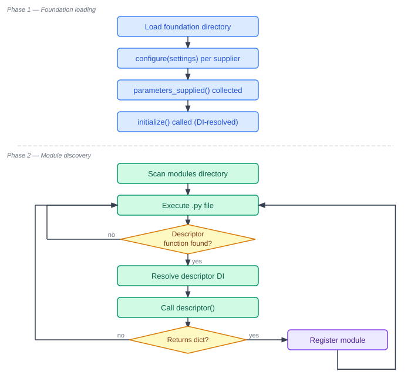
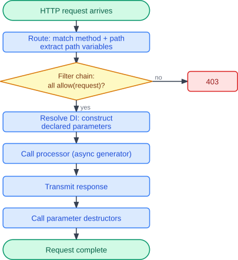

pavao
=====

**pavao** (from "Pavão", Portuguese for *peacock*) is a Python ASGI framework built on two
ideas that work together.

One is **modularity**: point pavao at a directory of Python files and it discovers and
serves every endpoint module it finds there. Each module is defined by a specifically named function
that returns the necessary metadata for registration. Adding a new endpoint means dropping a
file into the directory; removing one means deleting it. Nothing else in the application needs
to change.

The other is **name-based dependency injection**: instead of importing or constructing the
objects your endpoint needs, you just declare them as arguments to your handler function. pavao
uses the names of the parameters to deliver the correct objects where they are requested. No wiring
code, no request context to thread through call stacks. Parameters are also instantiated on
demand: if a module does not declare ``db_connection``, no database connection is created for
it — each module only pays for what it uses.

These two ideas combine: every module file is self-contained, and every function inside it
asks for exactly what it needs and nothing more.

A minimal endpoint file looks like this:

.. literalinclude:: codes/hello.py
   :language: python

``process`` declares that it needs ``response``. pavao injects it. ``pavao_endpoint``
returns a dict with the method, path, and processor — that is the entire contract.
Save it anywhere inside your modules directory and pavao will serve it. That is all.

Quick start
-----------

Create a virtual environment, install pavao, and drop the file above into a new
``modules/`` directory:

.. code-block:: console

   $ python -m venv .venv
   $ source .venv/bin/activate
   $ pip install pavao
   $ mkdir modules

Save the ``hello.py`` example above as ``modules/hello.py``, then start the server:

.. code-block:: console

   $ python -m pavao modules/

Open ``http://localhost:8000/hello`` in a browser and you should see ``World``.

Features
--------

- Point-and-serve module directory: endpoints, tasks, and services auto-discovered at startup
- Dependency injection by parameter name across all modules
- Typed URL path variables and URL query parameters
- Schema-based YAML configuration with environment variable substitution
- Endpoint access filtering with full DI support
- Asynchronous inter-module communication bus
- Scheduled tasks (cron-style) and always-on background services
- Typed JSON parsing and serialization via `jsonbp <https://github.com/vottini/jsonbp>`_
- Server-Sent Events (SSE) with heartbeat and disconnection support
- Hot-reloading of modules on file change
- Response internationalization

Going further
-------------

Both pillars extend naturally as an application grows.

On the modularity side, modules can be organised into subdirectories, share helper code
through plain Python imports, and be hot-reloaded on change without restarting the server.
Alongside endpoint modules, the same directory can contain scheduled task modules
(``pavao_task()``) and always-on background service modules (``pavao_service()``).

On the injection side, the built-in injectables — ``request``, ``response``,
``path_variables``, ``broadcasting``, and others — cover the common cases. The set is open:
custom suppliers placed in a foundation directory can introduce new named parameters, making
application-specific resources (database connections, caches, auth tokens) available to any
module that declares them.

Crucially, injection applies to descriptor functions too, not only to processors. A module
can declare a dependency in its ``pavao_endpoint()`` function and use it to decide whether
to register at all, or to configure the endpoint based on runtime state. The following
example, from `pavao-auth <https://github.com/vottini/pavao-auth>`_, illustrates how far
this can go:

.. literalinclude:: codes/logout.py
   :language: python

The descriptor receives ``loaded_settings`` and checks a configuration flag. If the v1 API
is disabled the descriptor returns ``None`` and the module is quietly skipped. Otherwise the
endpoint is registered, and its processor independently declares its own dependencies:
``server``, ``response``, ``db_connection``, and ``auth_data`` are all resolved and injected
at request time. Each function asks for exactly what it needs — nothing is shared implicitly.
This approach to component wiring was inspired by how `Spring <https://spring.io>`_
works in Java.

How it works
------------

When the server starts, pavao goes through two phases. First it loads the foundation
directory: each supplier is instantiated, configured, and asked what parameters it
provides. Only then does it scan the modules directory, executing each file and calling
any descriptor function it finds — with the declared dependencies already resolved.

Incoming requests follow a fixed pipeline: the router matches the path, the filter
chain decides whether the request is allowed, the declared parameters are constructed
from their suppliers, the processor runs, and the response is transmitted. Acquired
resources are released via destructors once the response is complete.

.. toctree::
   :maxdepth: 2
   :caption: Contents:

   sections/endpoints
   sections/decorators
   sections/background
   sections/messaging
   sections/foundation
   sections/running
   sections/extensions
